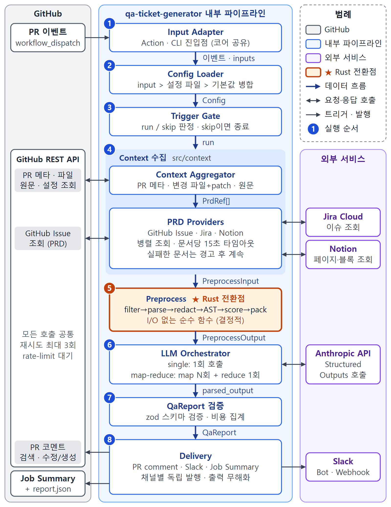

# qa-ticket-generator

**English** | [한국어](docs/README.ko.md) | [日本語](docs/README.ja.md) | [简体中文](docs/README.zh-CN.md)

<!-- Badges (CI, release, license) are added when the repository is published. -->

> 🚧 pre-v0.1. It works on our test repos, but inputs and the comment layout can still change.

A GitHub Action that reads a spec (a GitHub issue, a Jira story or a Notion page) and writes the test cases
a QA person would run, one ticket per case, including the ones that are easy to miss. When the pull request
for that spec comes in, it checks the code against those cases and tells you which ones look implemented.

## Why

On small teams there is usually no dedicated QA person, and the reviewer rarely has the Jira ticket open
next to the diff. So a PR gets approved, the tests pass, and a week later someone notices that one of the
acceptance criteria never got built.

This action does the QA groundwork for you. It reads the spec before anyone writes code and turns every
acceptance criterion into concrete test cases, the boundary and failure cases included. Later it reads the
PR and checks each case against the code. It is not a code reviewer and it won't comment on style. It only
cares whether the change does what the spec says, and what you should test to find out.

## How it works

1. Plan. Add the `needs-qa-plan` label to a spec issue, or run the workflow by hand with a Jira key or a
   Notion URL. Claude goes through each acceptance criterion with the usual test techniques (boundaries,
   invalid input, permissions, concurrency, time zones and so on) and writes the cases, including the
   things the spec doesn't say.
2. Case tickets. Each case becomes a ticket where your team already works: a GitHub issue, a Jira sub-task
   under the story, or a row in a Notion database. You also get `qa-cases.md`, `.csv` and `.json` files;
   the CSV imports into TestRail or a spreadsheet. The spec gets one comment that lists the cases.
3. PR check. Add `needs-ai-qa` to a PR that links the spec. Every case gets a code status (implemented,
   possibly missing, contradicts the spec, or can't tell from the code), risks that only show up in the
   diff become new cases, and the PR gets a summary with a P0 checklist. If the spec hasn't been planned
   yet, this step plans it first.

Running it again is safe. A case keeps its ID and its ticket, so nothing is duplicated. Results,
assignees, comments and labels your team adds are never overwritten. If someone edited a ticket's text, the
tool leaves it alone and posts the change it would have made as a comment. Cases that drop out of the spec
are marked as obsolete, not closed or deleted.

Later runs only do what is needed. If the spec hasn't changed since the last plan, no cases are written
again (set `force-plan: true` to plan anyway). The PR check skips a commit it has already checked, and a
push that only changes comments or whitespace. After the first check, new cases only come from the lines
that changed, and a case keeps its status unless a file it rests on changed or it was still waiting for
code. Running the workflow by hand checks everything again.

Setting up Jira or Notion takes a few extra minutes:
[`docs/setup/jira-subtasks.md`](docs/setup/jira-subtasks.md) and
[`docs/setup/notion-qa-database.md`](docs/setup/notion-qa-database.md).

## What you get

One case ticket, as the tool writes it (titled `[P0][Boundary] Apply a coupon that expired one second ago`):

```markdown
### Preconditions

- Coupon EXP1 issued, expires 2026-11-13 23:59:59
- Cart subtotal 30,000 KRW

### Test data

- Coupon code EXP1
- Clock 2026-11-14 00:00:00

### Steps

1. Open checkout
2. Enter EXP1 and apply

### Expected result

- **Toast "This coupon has expired"**
- Total stays 30,000 KRW

### Why it is easy to miss

The spec does not say whether the expiry second itself is still valid

### Related AC

AC3
```

On the PR, the comment starts with how well the change matches the spec, then lists the cases the code
seems to miss or contradict and a P0 checklist, each linked to its ticket. When you push more commits, the
same comment is updated instead of a new one being added, and pushes that only touch lockfiles or build
output are ignored.

If you want the check to fail, look at `fail-on`. When a requirement's main behaviour is there but some of
its cases look missing or contradicted, the requirement counts as partly met and the badge says partially
aligned. So `fail-on: misaligned` only fails when the main behaviour goes against the spec. Use
`fail-on: partial` if edge cases should block the merge too.

A PR that links no spec still gets a comment: requirements are inferred from the code, with a short list of
test cases and a note that there was no spec to compare with. If you connect Slack, a short summary of this
comment goes to a channel and the test cases go into its thread.

Here is how a run flows, if you are curious:



## Setup

You need an Anthropic API key and about five minutes.

1. Add the key as a repository secret named `ANTHROPIC_API_KEY`.
2. Create two labels: `needs-qa-plan` for specs and `needs-ai-qa` for PRs.
3. Add this workflow as `.github/workflows/qa-cases.yml`:

```yaml
name: QA cases
on:
  issues:
    types: [labeled]
  pull_request:
    types: [labeled, synchronize, opened, reopened]
  workflow_dispatch:
    inputs:
      spec: { description: "Issue number, Jira key or Notion URL", required: false }

permissions:
  contents: read
  issues: write
  pull-requests: write

jobs:
  qa:
    if: >-
      github.event_name == 'workflow_dispatch' ||
      (github.event_name == 'issues' && github.event.label.name == 'needs-qa-plan') ||
      (github.event_name == 'pull_request' && contains(github.event.pull_request.labels.*.name, 'needs-ai-qa'))
    concurrency:
      group: qa-cases-${{ github.event.issue.number || github.event.pull_request.number || inputs.spec }}
      cancel-in-progress: ${{ github.event_name == 'pull_request' }}
    runs-on: ubuntu-latest
    steps:
      # No actions/checkout here on purpose: the action reads everything through the API.
      - id: qa
        uses: ggreing/qa-ticket-generator@v0
        with:
          anthropic-api-key: ${{ secrets.ANTHROPIC_API_KEY }}
      - if: steps.qa.outputs.cases-dir != ''
        uses: actions/upload-artifact@cf430e030ddbb5b0abf93d22962f4752f3646cd9 # v7.0.2
        with:
          name: qa-cases
          path: ${{ steps.qa.outputs.cases-dir }}
```

That's it. Label a spec issue and the case issues appear, then label the PR that implements it. The
commented version in [`docs/examples/workflow-v3.yml`](docs/examples/workflow-v3.yml) shows the Jira and
Notion inputs. If you only want the PR comment, without case tickets, use
[`docs/examples/workflow.yml`](docs/examples/workflow.yml). Output in Korean, Japanese or Chinese is one
line: `language: ko` (or `ja`, `zh-CN`).

Fork PRs are skipped by default, because GitHub doesn't give them your secrets. There is an opt-in
workflow in [`docs/examples/workflow-fork-opt-in.yml`](docs/examples/workflow-fork-opt-in.yml); please read
the warning at the top before using it.

## Linking the spec

For planning, the spec is the issue you label or the `spec` you give a manual run. For the PR check, the
action looks for the spec link in the PR description:

- GitHub issues: `#123`, `owner/repo#123`, a full issue URL, or `Closes #123`
- Jira Cloud: `https://your-site.atlassian.net/browse/PROJ-123`, or just `PROJ-123` if you list `PROJ` in
  `jira-project-keys`
- Notion: a `notion.so` or `notion.site` page URL

It reads acceptance criteria from a list under an "Acceptance Criteria" (or "AC") heading, or from a
checklist. If there is no such section it works from the whole ticket body. Links inside code blocks and
HTML comments are ignored, so the examples in a PR template won't be picked up. We ship one you can copy:
[`docs/examples/pull_request_template.md`](docs/examples/pull_request_template.md).

No ticket linked? It still runs, works from the code alone, and says so at the top of the comment. Set
`require-prd: true` if you'd rather have the check fail.

## Running it locally

The same thing runs as a CLI. By default it doesn't post anything: `plan` only writes the `qa-cases`
files and `run` only prints the report.

```bash
export GITHUB_TOKEN=… ANTHROPIC_API_KEY=…
npx qa-ticket-generator plan --repo owner/repo --spec PROJ-123                                # files only
npx qa-ticket-generator plan --repo owner/repo --spec 42 --sinks github-issue --publish       # create tickets
npx qa-ticket-generator run --repo owner/repo --pr 123            # dry run (default)
npx qa-ticket-generator run --repo owner/repo --pr 123 --format json --out report.json
npx qa-ticket-generator run --repo owner/repo --pr 123 --publish  # write the PR comment / Slack message
```

Any action input also works as an upper-case environment variable (`JIRA_BASE_URL`, `MAX_SCENARIOS`, …).
`npx qa-ticket-generator --help` lists the flags.

## What it costs

On the small PRs we have tried so far (one to three changed files), a run with Claude Opus 5.5 costs about
$0.09 to $0.19, $0.13 on average, and takes about a minute. That was measured on 10 synthetic PRs and one
sandbox PR, so treat it as a ballpark.

Bigger PRs are split into several calls and cost more, so every run has a ceiling: `max-cost-usd`, $2 by
default. If a run would go over it, the least important files are left out and the comment lists them. The
estimated cost of each run is printed at the bottom of the comment.

Planning a spec is a bigger job, because the cases are written a few acceptance criteria at a time and then
merged. We expect about $0.5 to $2 per spec, but we haven't measured it yet. The same `max-cost-usd`
ceiling applies, and `max-cases` (80 by default) caps how many cases one spec can produce; P2 cases are the
first to go.

## Where your code goes

The action never checks out or runs the code in the PR. It reads the diff, the changed files and the linked
tickets through the GitHub, Jira and Notion APIs, and sends them to Anthropic's API. Nothing goes anywhere
else, and there is no telemetry.

Before anything is sent, things that look like secrets (API keys, tokens, private keys, passwords in config)
are masked, including in the PR title and description. The comment tells you how many were masked. Logs only
contain counts and sizes, never file contents.

Two more things worth knowing:

- The repository config file is read from the base branch, so a PR can't change the instructions it is
  reviewed with. Text written by the model is escaped before it is posted, Slack mentions are disabled, and
  links are limited to the PR, the linked tickets and your repository.
- Between runs the action keeps a little state in a hidden block of its own comment, and only trusts comments
  written by its own token (`github-actions[bot]` or the owner of the PAT you passed). If another workflow in
  your repository posts PR-author text as `github-actions[bot]`, that state could be faked. The worst outcome
  is a skipped re-run or the wrong Slack message being edited.

Found a security problem? Please report it privately, see [`SECURITY.md`](SECURITY.md).

## Known gaps

- Labeling a PR that was opened _before_ you added the workflow may do nothing. GitHub doesn't refresh that
  PR's merge commit, so it never sees the new workflow. Update the branch (the "Update branch" button or
  `gh pr update-branch <number>`) and the next push starts a run.
- Slack only hears about PRs that link no spec. Plan runs and PR checks against case tickets don't post
  there yet.
- Slack incoming webhooks can only post, so each run adds a new message. For update-in-place and threads,
  use a bot token (`slack-bot-token` and `slack-channel`).
- The default `GITHUB_TOKEN` can't read issues in other private repositories. Pass a personal access token
  or GitHub App token as `github-token` if your specs live elsewhere.
- Jira Cloud only (no Server or Data Center), and github.com only (no GitHub Enterprise Server) for now.
- Notion pages have to be shared with your integration (page menu → Connections).
- Jira sub-tasks need a Jira story to hang under. With a spec written as a GitHub issue or a Notion page,
  the Jira sink is skipped and the run log says so.
- Notion gets the case rows but no list of cases per spec, because one database holds the cases of every
  spec. The spec's GitHub issue or Jira story gets that list instead.
- The model only sees the changed files. If a requirement is handled in a file the PR doesn't touch, it may
  be reported as missing; the comment lists that kind of assumption at the end.
- We still call GitHub's REST API without a version header, so GitHub answers with version 2022-11-28 and
  marks the issue endpoints as deprecated. That version works until March 2028; we plan to move to
  2026-03-10 before then.
- Code statuses are the model's judgement. A manual run checks everything again and can flip a few of them.
- The `qtg.case` issue property the Jira sink uses hasn't been tried on a real Jira site yet.
- The Notion sink hasn't been tried in a real Notion workspace yet.

## Configuration reference

### Inputs

<!-- inputs:start -->
| Input                   | Required | Default                           | Description                                                                                            |
| ----------------------- | -------- | --------------------------------- | ------------------------------------------------------------------------------------------------------ |
| `anthropic-api-key`     | ✅       | —                                 | Anthropic API key.                                                                                     |
| `github-token`          |          | `${{ github.token }}`             | Used to read the PR and write the comment.                                                             |
| `model`                 |          | `claude-opus-5-5`                 | Claude model id.                                                                                       |
| `effort`                |          | `high`                            | `low`, `medium`, `high`, `xhigh` or `max`. Lower is cheaper and faster.                                |
| `language`              |          | `en`                              | `en`, `ko`, `ja` or `zh-CN` (`kr`, `jp`, `cn`, `zh` work too).                                         |
| `trigger-label`         |          | `needs-ai-qa`                     | The label that starts a run.                                                                           |
| `rerun-on-push`         |          | `true`                            | Run again on new commits while the label is on the PR.                                                 |
| `require-prd`           |          | `false`                           | Fail the check when no linked ticket can be read.                                                      |
| `token-budget`          |          | `150000`                          | Input tokens per model call. Bigger PRs are split into several calls.                                  |
| `max-cost-usd`          |          | `2.00`                            | Cost ceiling per run. Less important files are dropped to stay under it.                               |
| `max-scenarios`         |          | `8`                               | Maximum number of test cases in the comment.                                                           |
| `comment-author`        |          | —                                 | Only needed with a custom GitHub App token, e.g. `my-app[bot]`.                                        |
| `pr-comment`            |          | `true`                            | Post (and keep updating) the PR comment.                                                               |
| `slack-bot-token`       |          | —                                 | Slack bot token (`xoxb-`). Gives you update-in-place and threads.                                      |
| `slack-channel`         |          | —                                 | Channel id or `#name` for the bot.                                                                     |
| `slack-webhook-url`     |          | —                                 | Incoming webhook, used when there is no bot token.                                                     |
| `jira-base-url`         |          | —                                 | e.g. `https://acme.atlassian.net`.                                                                     |
| `jira-email`            |          | —                                 | Jira account email.                                                                                    |
| `jira-api-token`        |          | —                                 | Jira API token. Jira is used when URL, email and token are all set.                                    |
| `jira-project-keys`     |          | —                                 | Comma-separated keys to recognize bare `KEY-123` references, e.g. `PROJ,WEB`.                          |
| `notion-token`          |          | —                                 | Notion integration token.                                                                              |
| `config-path`           |          | `.github/qa-ticket-generator.yml` | Repository config file, read from the base branch.                                                     |
| `fail-on`               |          | `none`                            | Fail the check when alignment is `partial` or `misaligned`.                                            |
| `fail-on-error`         |          | `false`                           | Fail the check on internal errors. By default they only show as a warning.                             |
| `allow-fork-prs`        |          | `false`                           | Allow fork PRs. Only use this with the opt-in workflow.                                                |
| `server-fallback`       |          | `true`                            | Let Anthropic retry on another model if Opus declines a request.                                       |
| `mode`                  |          | `auto`                            | `auto` decides from the event, `plan` turns a spec into QA cases, `verify` checks a PR.                |
| `spec`                  |          | —                                 | Spec for a manual plan run: issue number, Jira key or Notion URL.                                      |
| `plan-label`            |          | `needs-qa-plan`                   | Issue label that starts the plan phase.                                                                |
| `sinks`                 |          | `github-issue,file`               | Where case tickets go: `jira`, `github-issue`, `notion`, `file`.                                       |
| `notion-qa-database-id` |          | —                                 | Notion database for QA cases.                                                                          |
| `jira-subtask-type`     |          | `Sub-task`                        | Jira issue type for case sub-tasks.                                                                    |
| `force-plan`            |          | `false`                           | Plan again even if the spec has not changed.                                                           |
| `max-cases`             |          | `80`                              | Safety cap per spec. P2 cases go first.                                                                |
| `previous-cases`        |          | —                                 | `qa-cases.json` from an earlier run, e.g. a downloaded artifact. The file sink keeps case IDs from it. |
| `dry-run`               |          | `false`                           | Write the report to the job summary only.                                                              |
<!-- inputs:end -->

### Outputs

<!-- outputs:start -->
| Output             | Description                                               |
| ------------------ | --------------------------------------------------------- |
| `report-path`      | Path to `report.json` with the full result.               |
| `case-count`       | Active QA cases after a plan run.                         |
| `cases-dir`        | Folder with qa-cases.md, .csv and .json after a plan run. |
| `scenario-count`   | How many test cases were written.                         |
| `alignment-status` | `aligned`, `partial`, `misaligned` or `no_prd`.           |
| `cost-usd`         | Estimated cost of the run.                                |
| `skipped-reason`   | Why the run was skipped, if it was.                       |
<!-- outputs:end -->

### Repository config file

You can put `.github/qa-ticket-generator.yml` in your repository to exclude paths, tell it which Jira field
holds your acceptance criteria, or add a few lines of domain context. Action inputs win over this file. The
full example is in [`docs/examples/qa-ticket-generator.yml`](docs/examples/qa-ticket-generator.yml).

```yaml
filters:
  exclude: ["**/*.snap", "src/generated/**"]
prd:
  jiraProjectKeys: [PROJ, WEB]
  jiraAcceptanceCriteriaField: customfield_10042
prompt:
  extraInstructions: |
    Partial refunds are supported.
```

## Contributing

Bug reports and PRs are welcome. [`CONTRIBUTING.md`](CONTRIBUTING.md) explains how to run the tests (they
never call real APIs). The design notes are in [`docs/SPEC.ko.md`](docs/SPEC.ko.md) (Korean for now) and
[`docs/adr/`](docs/adr/).

Apache-2.0, see [LICENSE](LICENSE).
