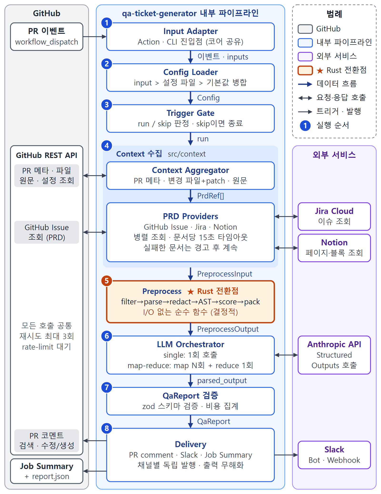

# qa-ticket-generator

[English](../README.md) | [한국어](README.ko.md) | **日本語** | [简体中文](README.zh-CN.md)

<!-- バッジ(CI、リリース、ライセンス)はリポジトリ公開時に追加します。 -->

> 🚧 pre-v0.1 です。手元のテスト用リポジトリでは動いていますが、input 名やコメントの見た目はまだ変わるかもしれません。

仕様(GitHub issue、Jira のストーリー、Notion のページ)を読んで、QA 担当者が実行するテストケースを
1 ケースずつチケットにする GitHub Action です。見落としやすいケースも拾います。その仕様を実装した PR が
来たら、コードとケースを突き合わせて、どのケースが実装済みに見えるかを知らせます。

## Why

小さなチームには QA 専任がいないことが多く、レビュアーも diff を見ながら Jira のチケットを横に開いている
わけではありません。その結果、レビューも通ってテストも緑なのに、一週間後に受け入れ条件がひとつ丸ごと
実装されていなかったと気づく、ということが起きます。

このアクションがその QA の下準備を代わりにやります。コードを書く前に仕様を読み、受け入れ条件ごとに
境界値や失敗時も含めた具体的なテストケースを作ります。あとで PR が来たら、ケースを 1 つずつコードと
突き合わせます。コードレビューのボットではないので、スタイルには口を出しません。変更が仕様どおりか、それを
確かめるには何をテストすべきか、だけを見ます。

## How it works

1. 計画。仕様の issue に `needs-qa-plan` ラベルを付けるか、Jira のキーや Notion の URL を指定して
   ワークフローを手動で実行します。Claude が受け入れ条件ごとによく使うテスト技法(境界値、不正な入力、
   権限、同時実行、タイムゾーンなど)を当てはめてケースを書きます。仕様に書かれていないこともケースにします。
2. ケースのチケット。ケースごとに、チームがふだん使っている場所にチケットができます。GitHub issue、
   ストーリーの下の Jira サブタスク、Notion データベースの行から選べます。`qa-cases.md`、`.csv`、`.json`
   のファイルも出力され、CSV は TestRail やスプレッドシートに取り込めます。仕様にはケース一覧のコメントが
   1 つ付きます。
3. PR との突き合わせ。仕様にリンクした PR に `needs-ai-qa` を付けます。ケースごとにコードの状態(実装を確認、
   未実装の疑い、仕様と矛盾、コードからは判断できない)が付き、diff にしか現れないリスクは新しいケースとして
   追加されます。PR には P0 チェックリスト入りの要約コメントが残ります。まだケースを作っていない仕様なら、
   このステップで先に作ります。

何度実行しても大丈夫です。同じケースは ID もチケットもそのままなので、重複はできません。チームが書いた
実行結果、担当者、コメント、ラベルは上書きしません。誰かがチケットの本文を直していたらそのままにして、
ツールが書き換えようとした内容をコメントで残します。仕様から消えたケースは閉じたり消したりせず、対象外として
印を付けます。

2 回目以降の実行は必要なことだけをします。前回の計画から仕様が変わっていなければ、ケースは作り直しません
(それでも作り直すなら `force-plan: true`)。PR との突き合わせでは、もう突き合わせたコミットと、コメントや
空白だけが変わった push はスキップします。最初の突き合わせのあとは、変わった行からだけ新しいケースを作り、
ケースは根拠にしたファイルが変わったときか、まだコードを待っていたときだけ判定し直します。ワークフローを
手動で実行すると、最初から全部見直します。

Jira や Notion を使うには、もう少し設定が必要です:
[`setup/jira-subtasks.md`](setup/jira-subtasks.md)、
[`setup/notion-qa-database.md`](setup/notion-qa-database.md)。

## What you get

ツールが書くケースのチケットは、1 件だとこんな形です(タイトルは `[P0][境界値] 有効期限を1秒過ぎたクーポンの適用を拒否`):

```markdown
### 前提条件

- クーポン EXP1 発行済み、期限 2026-11-13 23:59:59
- カート小計 30,000ウォン

### テストデータ

- クーポンコード EXP1
- 現在時刻 2026-11-14 00:00:00

### 手順

1. 決済画面を開く
2. EXP1 を入力して適用

### 期待結果

- **「期限切れのクーポンです」トースト表示**
- 支払金額 30,000ウォンのまま

### 見落としやすい理由

仕様に有効期限の秒を含むか(以下/未満)の定義がない

### 関連AC

AC3
```

PR のコメントは、変更が仕様とどのくらい合っているかから始まり、コードが見落としていそうなケースや仕様と
食い違っていそうなケース、P0 チェックリストを、チケットへのリンク付きで並べます。コミットを追加で push すると
新しいコメントを増やさずに同じコメントを書き換え、lock ファイルやビルド成果物だけの push は無視します。

チェックを失敗させたいときは `fail-on` を見てください。要件の基本の動作はあるのに、一部のケースが未実装の
疑いや仕様と矛盾になっていると、その要件は一部充足になり、バッジは一部一致になります。なので
`fail-on: misaligned` が失敗するのは、基本の動作が仕様と逆のときだけです。境界のケースまでマージを止めたい
なら `fail-on: partial` を使ってください。

仕様にリンクしていない PR にもコメントは付きます。その場合はコードから要件を推測して短いテストケースの一覧を
書き、突き合わせる仕様がなかったことも書き添えます。Slack をつなぐと、チャンネルにはこのコメントの短い要約、
そのスレッドにテストケースが流れます。

中の流れが気になる方はこちら。



## Setup

必要なのは Anthropic の API キーと 5 分ほどの時間です。

1. リポジトリの secret に `ANTHROPIC_API_KEY` という名前でキーを登録します。
2. ラベルを 2 つ作ります。仕様用の `needs-qa-plan` と、PR 用の `needs-ai-qa` です。
3. 次のワークフローを `.github/workflows/qa-cases.yml` として追加します。

```yaml
name: QA cases
on:
  issues:
    types: [labeled]
  pull_request:
    types: [labeled, synchronize, opened, reopened]
  workflow_dispatch:
    inputs:
      spec: { description: "Issue number, Jira key or Notion URL", required: false }

permissions:
  contents: read
  issues: write
  pull-requests: write

jobs:
  qa:
    if: >-
      github.event_name == 'workflow_dispatch' ||
      (github.event_name == 'issues' && github.event.label.name == 'needs-qa-plan') ||
      (github.event_name == 'pull_request' && contains(github.event.pull_request.labels.*.name, 'needs-ai-qa'))
    concurrency:
      group: qa-cases-${{ github.event.issue.number || github.event.pull_request.number || inputs.spec }}
      cancel-in-progress: ${{ github.event_name == 'pull_request' }}
    runs-on: ubuntu-latest
    steps:
      # あえて actions/checkout は入れません。中身はすべて API で読みます。
      - id: qa
        uses: ggreing/qa-ticket-generator@v0
        with:
          anthropic-api-key: ${{ secrets.ANTHROPIC_API_KEY }}
      # この step では upload-artifact が Node のバージョンや deprecation の警告を出すことがありますが、アップロードには影響しません。
      - if: steps.qa.outputs.cases-dir != ''
        uses: actions/upload-artifact@ea165f8d65b6e75b540449e92b4886f43607fa02 # v4.6.2
        with:
          name: qa-cases
          path: ${{ steps.qa.outputs.cases-dir }}
```

これで終わりです。仕様の issue にラベルを付けるとケースの issue ができるので、あとはその仕様を実装した PR に
ラベルを付けてください。Jira と Notion の input はコメント付きで
[`examples/workflow-v3.yml`](examples/workflow-v3.yml) に載っています。ケースのチケットは要らず PR の
コメントだけでよければ [`examples/workflow.yml`](examples/workflow.yml) を使ってください。日本語で出力したい
ときは `language: ja` を 1 行足すだけです。

fork からの PR はデフォルトでスキップします。GitHub が fork の PR には secret を渡さないためです。どうしても
必要なら [`examples/workflow-fork-opt-in.yml`](examples/workflow-fork-opt-in.yml) を使えますが、先頭の
警告は必ず読んでください。

## Linking the spec

計画では、ラベルを付けた issue か、手動実行で渡した `spec` が仕様になります。PR との突き合わせでは、PR の
説明文から仕様へのリンクを探します。

- GitHub issue: `#123`、`owner/repo#123`、issue の URL、`Closes #123`
- Jira Cloud: `https://your-site.atlassian.net/browse/PROJ-123`。`jira-project-keys` に `PROJ` を入れて
  おけば `PROJ-123` だけでも認識します
- Notion: `notion.so` または `notion.site` のページ URL

受け入れ条件は「Acceptance Criteria」(または「AC」)見出しの下のリストか、チェックリストから読みます。
そういうセクションがなければチケット本文全体から判断します。コードブロックや HTML コメントの中のリンクは
無視するので、PR テンプレートに例のリンクを書いておいても大丈夫です。すぐ使えるテンプレートもあります:
[`examples/pull_request_template.md`](examples/pull_request_template.md)。

チケットを紐づけていない場合も、コードだけを見て動き、コメントの先頭でそのことを知らせます。いっそチェックを
失敗させたいなら `require-prd: true` を使ってください。

## Running it locally

同じものを CLI としても使えます。デフォルトではどこにも投稿しません。`plan` は `qa-cases` のファイルを
書くだけ、`run` はレポートを表示するだけです。

```bash
export GITHUB_TOKEN=… ANTHROPIC_API_KEY=…
npx qa-ticket-generator plan --repo owner/repo --spec PROJ-123                                # ファイルのみ
npx qa-ticket-generator plan --repo owner/repo --spec 42 --sinks github-issue --publish       # チケットを作成
npx qa-ticket-generator run --repo owner/repo --pr 123            # ドライラン(デフォルト)
npx qa-ticket-generator run --repo owner/repo --pr 123 --format json --out report.json
npx qa-ticket-generator run --repo owner/repo --pr 123 --publish  # PR コメント / Slack に投稿
```

アクションの input はすべて大文字の環境変数としても渡せます(`JIRA_BASE_URL`、`MAX_SCENARIOS` など)。
フラグの一覧は `npx qa-ticket-generator --help` で見られます。

## What it costs

これまで試した小さな PR(変更ファイル 1〜3 個)では、Claude Opus 5.5 で 1 回あたり $0.09〜0.19、平均 $0.13
ほどで、1 分くらいかかりました。合成 PR 10 件とサンドボックスの PR 1 件で測った値なので、目安として見てください。

大きな PR は何回かに分けて呼ぶので、そのぶん高くなります。そのため実行ごとに上限があります。`max-cost-usd`
で、デフォルトは $2 です。超えそうなときは重要度の低いファイルから外し、外したものをコメントに書きます。
各実行の見積もりコストはコメントの一番下に出ます。

仕様からケースを作るほうが大きな仕事です。受け入れ条件をいくつかずつ分けてケースを書き、あとでまとめるから
です。仕様 1 つで $0.5〜2 ほどと見ていますが、まだ測ってはいません。同じ `max-cost-usd` の上限がかかり、
`max-cases`(デフォルト 80)で仕様 1 つあたりのケース数も抑えます。超えたら P2 から外します。

## Where your code goes

このアクションは PR のコードを checkout も実行もしません。diff、変更されたファイル、紐づいたチケットを
GitHub・Jira・Notion の API で読み、Anthropic の API に送ります。それ以外には送らず、テレメトリもありません。

送る前に、秘密情報らしきもの(API キー、トークン、秘密鍵、設定ファイル内のパスワード)はマスクします。
PR のタイトルと説明文も同じです。いくつマスクしたかはコメントに出ます。ログには件数とサイズだけが残り、
ファイルの中身は残りません。

知っておいてほしいことが 2 つあります。

- リポジトリの設定ファイルは base ブランチから読みます。なので PR が自分をレビューする指示を書き換えることは
  できません。モデルが書いたテキストはエスケープしてから投稿し、Slack のメンションは無効化し、リンクは
  PR・紐づいたチケット・リポジトリだけに制限します。
- 実行と実行のあいだの状態を自分のコメントの隠しブロックに保存し、自分のトークン(`github-actions[bot]`
  か、渡した PAT の持ち主)が書いたコメントだけを信用します。同じリポジトリの別のワークフローが PR 作成者の
  文章を `github-actions[bot]` 名義でそのまま投稿していると、この状態が偽装されるおそれがあります。最悪でも
  再実行がスキップされるか、別の Slack メッセージが書き換えられる程度です。

セキュリティの問題を見つけたら、公開 issue ではなく非公開で知らせてください。[`SECURITY.md`](../SECURITY.md)
を参照してください。

## Known gaps

- ワークフローを追加する*前*に開かれた PR は、ラベルを付けても何も起きないことがあります。GitHub がその PR の
  merge コミットを更新しないため、新しいワークフローが見えないからです。ブランチを更新すれば(「Update branch」
  ボタンか `gh pr update-branch <number>`)、次の push から動きます。
- Slack に流れるのは、仕様にリンクしていない PR だけです。計画の実行やケースのチケットとの突き合わせは、
  まだ Slack には送りません。
- Slack の incoming webhook は投稿しかできないので、実行のたびに新しいメッセージが増えます。同じメッセージの
  更新やスレッドを使いたい場合は bot トークン(`slack-bot-token` と `slack-channel`)を使ってください。
- デフォルトの `GITHUB_TOKEN` では、ほかの private リポジトリの issue は読めません。仕様が別のリポジトリに
  あるなら、PAT か GitHub App のトークンを `github-token` に渡してください。
- 今のところ Jira は Cloud のみ(Server、Data Center は非対応)、GitHub は github.com のみ(GHES は非対応)です。
- Notion のページはインテグレーションに共有しておく必要があります(ページメニュー → コネクト)。
- Jira のサブタスクには、ぶら下げる先の Jira ストーリーが必要です。仕様が GitHub issue や Notion のページ
  なら Jira はスキップし、実行ログにそう書きます。
- Notion にはケースの行はできますが、仕様ごとのケース一覧はありません。1 つのデータベースにすべての仕様の
  ケースが入るからです。一覧は仕様の GitHub issue か Jira ストーリーに付きます。
- モデルが見るのは変更されたファイルだけです。PR が触っていないファイルで処理されている要件は「未実装」と
  出ることがあり、そうした前提はコメントの最後にまとめて書きます。
- まだ GitHub REST API をバージョンヘッダーなしで呼んでいます。そのため GitHub は 2022-11-28 版で応答し、
  issue のエンドポイントを deprecated として扱います。この版は 2028 年 3 月まで使えるので、それまでに
  2026-03-10 へ移る予定です。
- コードの状態はモデルの判断です。全部見直す手動実行では、いくつか変わることがあります。
- Jira sink が使う issue property(`qtg.case`)は、まだ実際の Jira サイトで確かめていません。
- Notion sink は、まだ実際の Notion ワークスペースで確かめていません。

## Configuration reference

### Inputs

<!-- inputs:start -->
| Input                   | 必須 | デフォルト                        | 説明                                                                                                        |
| ----------------------- | ---- | --------------------------------- | ----------------------------------------------------------------------------------------------------------- |
| `anthropic-api-key`     | ✅   | —                                 | Anthropic の API キー。                                                                                     |
| `github-token`          |      | `${{ github.token }}`             | PR の読み取りとコメントの書き込みに使用。                                                                   |
| `model`                 |      | `claude-opus-5-5`                 | Claude のモデル ID。                                                                                        |
| `effort`                |      | `high`                            | `low`、`medium`、`high`、`xhigh`、`max`。低いほど安くて速い。                                               |
| `language`              |      | `en`                              | `en`、`ko`、`ja`、`zh-CN`(`kr`、`jp`、`cn`、`zh` も可)。                                                    |
| `trigger-label`         |      | `needs-ai-qa`                     | 実行を始めるラベル。                                                                                        |
| `rerun-on-push`         |      | `true`                            | ラベルが付いているあいだ、新しいコミットごとに再実行。                                                      |
| `require-prd`           |      | `false`                           | 紐づいたチケットを読めなければチェックを失敗させる。                                                        |
| `token-budget`          |      | `150000`                          | モデル呼び出し 1 回の入力トークン。大きな PR は複数回に分割。                                               |
| `max-cost-usd`          |      | `2.00`                            | 1 回あたりのコスト上限。超える分は重要度の低いファイルから外す。                                            |
| `max-scenarios`         |      | `8`                               | コメントに入れるテストケースの最大数。                                                                      |
| `comment-author`        |      | —                                 | 独自の GitHub App トークンを使うときだけ指定。例: `my-app[bot]`。                                           |
| `pr-comment`            |      | `true`                            | PR コメントを投稿し、更新し続ける。                                                                         |
| `slack-bot-token`       |      | —                                 | Slack の bot トークン(`xoxb-`)。メッセージ更新とスレッドが使える。                                          |
| `slack-channel`         |      | —                                 | bot が投稿するチャンネル ID か `#名前`。                                                                    |
| `slack-webhook-url`     |      | —                                 | bot トークンがないときに使う incoming webhook。                                                             |
| `jira-base-url`         |      | —                                 | 例: `https://acme.atlassian.net`。                                                                          |
| `jira-email`            |      | —                                 | Jira アカウントのメールアドレス。                                                                           |
| `jira-api-token`        |      | —                                 | Jira の API トークン。URL・メール・トークンがそろうと Jira を使う。                                         |
| `jira-project-keys`     |      | —                                 | `KEY-123` だけでも認識するプロジェクトキーをカンマ区切りで。例: `PROJ,WEB`。                                |
| `notion-token`          |      | —                                 | Notion のインテグレーショントークン。                                                                       |
| `config-path`           |      | `.github/qa-ticket-generator.yml` | リポジトリの設定ファイル。base ブランチから読む。                                                           |
| `fail-on`               |      | `none`                            | 整合性が `partial` か `misaligned` ならチェックを失敗させる。                                               |
| `fail-on-error`         |      | `false`                           | 内部エラーでチェックを失敗させる。デフォルトは警告のみ。                                                    |
| `allow-fork-prs`        |      | `false`                           | fork の PR を許可。オプトインのワークフローでのみ使ってください。                                           |
| `server-fallback`       |      | `true`                            | Opus がリクエストを断ったら Anthropic が別モデルで再試行。                                                  |
| `mode`                  |      | `auto`                            | `auto` はイベントで判断、`plan` は仕様から QA ケースを作成、`verify` は PR を照合。                         |
| `spec`                  |      | —                                 | 手動実行時の仕様: issue 番号、Jira キー、Notion URL。                                                       |
| `plan-label`            |      | `needs-qa-plan`                   | 計画フェーズを始める issue ラベル。                                                                         |
| `sinks`                 |      | `github-issue,file`               | ケースチケットの作成先: `jira`、`github-issue`、`notion`、`file`。                                          |
| `notion-qa-database-id` |      | —                                 | QA ケースを入れる Notion データベース。                                                                     |
| `jira-subtask-type`     |      | `Sub-task`                        | ケースのサブタスクに使う Jira 課題タイプ。                                                                  |
| `force-plan`            |      | `false`                           | 仕様が変わっていなくても再生成する。                                                                        |
| `max-cases`             |      | `80`                              | 仕様ごとの安全上限。超えると P2 から外す。                                                                  |
| `previous-cases`        |      | —                                 | 前回実行の `qa-cases.json` のパス(例: ダウンロードしたアーティファクト)。file sink がケース ID を引き継ぐ。 |
| `dry-run`               |      | `false`                           | レポートを Job Summary にだけ書く。                                                                         |
<!-- inputs:end -->

### Outputs

<!-- outputs:start -->
| Output             | 説明                                                       |
| ------------------ | ---------------------------------------------------------- |
| `report-path`      | 結果全体が入った `report.json` のパス。                    |
| `case-count`       | 計画フェーズ後の有効な QA ケース数。                       |
| `cases-dir`        | 計画フェーズ後の qa-cases.md、.csv、.json があるフォルダ。 |
| `scenario-count`   | 書いたテストケースの数。                                   |
| `alignment-status` | `aligned`、`partial`、`misaligned`、`no_prd`。             |
| `cost-usd`         | 今回の実行の見積もりコスト。                               |
| `skipped-reason`   | スキップした場合はその理由。                               |
<!-- outputs:end -->

### Repository config file

リポジトリに `.github/qa-ticket-generator.yml` を置くと、除外するパス、受け入れ条件が入っている Jira の
フィールド、ドメインの説明を少し、といったことを指定できます。アクションの input がこのファイルより
優先されます。完全な例は [`examples/qa-ticket-generator.yml`](examples/qa-ticket-generator.yml) にあります。

```yaml
filters:
  exclude: ["**/*.snap", "src/generated/**"]
prd:
  jiraProjectKeys: [PROJ, WEB]
  jiraAcceptanceCriteriaField: customfield_10042
prompt:
  extraInstructions: |
    Partial refunds are supported.
```

## Contributing

バグ報告も PR も歓迎です。テストの動かし方は [`CONTRIBUTING.md`](../CONTRIBUTING.md) にあります(テストは
実際の API を呼びません)。設計メモは [`SPEC.ko.md`](SPEC.ko.md)(今は韓国語のみ)と [`adr/`](adr/) にあります。

ライセンスは Apache-2.0 です。[LICENSE](../LICENSE) をご覧ください。
