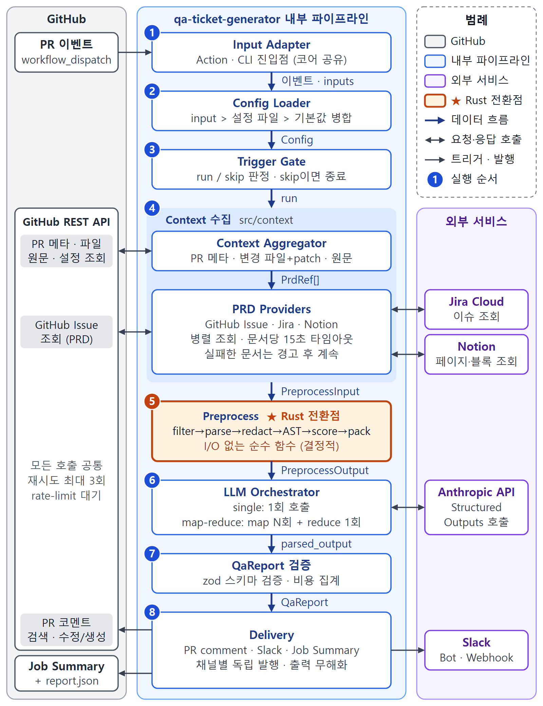

# qa-ticket-generator

[English](../README.md) | **한국어** | [日本語](README.ja.md) | [简体中文](README.zh-CN.md)

<!-- 배지(CI, 릴리스, 라이선스)는 레포를 공개할 때 추가합니다. -->

> 🚧 pre-v0.1입니다. 테스트 레포에서는 잘 돌아가지만, input 이름이나 코멘트 모양은 아직 바뀔 수 있어요.

PR과 그 PR이 구현해야 할 티켓을 같이 읽고, QA 담당자가 남길 법한 메모를 써 주는 GitHub Action입니다.
어떤 요구사항이 구현됐고 어떤 게 빠졌는지, 머지 전에 어떤 테스트를 돌려 보면 좋을지를 PR에 남겨 줍니다.

## Why

작은 팀에는 보통 QA 전담자가 없고, 리뷰어도 diff를 보면서 Jira 티켓을 옆에 띄워 두는 경우가 드뭅니다.
그러다 보니 리뷰 승인 나고 테스트도 다 통과했는데, 일주일 뒤에야 인수 조건 하나가 아예 구현이 안 됐다는 걸
알게 되는 일이 생깁니다.

이 액션이 그 대조 작업을 대신합니다. PR 본문에 티켓 링크를 넣고 `needs-ai-qa` 라벨을 붙이면, 1\~2분 뒤
Claude가 코드와 요구사항을 비교한 코멘트를 남깁니다. 코드 리뷰 봇은 아니라서 스타일 같은 건 보지 않습니다.
이 변경이 기획서대로 동작하는지, 그걸 확인하려면 뭘 테스트해야 하는지만 봅니다.

## What you get

코멘트는 대략 이런 모양입니다(v0.1 전까지 다듬는 중이에요):

```markdown
## 🧪 AI QA — 4e2455c · ⚠️ 부분 일치

**조치 필요 (2)**

- ❌ AC2 만료된 쿠폰은 거부한다: `expiresAt`을 현재 시각과 비교하는 코드가 없음 (`src/coupon.ts`)
- ❌ AC4 정률 할인은 최대 10,000원: 상한이 적용되지 않음

**P0 체크리스트**

- [ ] TC-01 1초 전에 만료된 쿠폰 → 거부, 사용 기록 남지 않음
- [ ] TC-02 같은 사용자가 같은 쿠폰을 동시에 두 번 적용 → 한 번만 성공
- [ ] TC-03 200,000원 주문에 10% 쿠폰 → 할인액 10,000원 (20,000원 아님)

<details><summary>TC-01 만료된 쿠폰 거부 [P0 · AC2]</summary>
전제: user-A는 EXP1을 쓴 적 없음, 장바구니 소계 30,000원
데이터: code = EXP1, expiresAt = 현재 - 1초
단계: 1. 결제 화면 열기 2. EXP1 적용
기대: "Coupon has expired" CouponError, (user-A, EXP1) 사용 기록 없음
</details>

<details><summary>P1 / P2 케이스 (9)</summary>…</details>
```

커밋을 더 push하면 새 코멘트를 다는 대신 같은 코멘트를 고칩니다. lock 파일이나 빌드 결과물만 바뀐 push는
무시합니다. Slack을 연결하면 채널에는 짧은 요약이, 그 스레드에는 테스트 케이스가 올라갑니다.

내부 흐름이 궁금하면 아래 그림을 보세요.



## Setup

Anthropic API 키 하나와 5분 정도면 됩니다.

1. 레포 secret에 `ANTHROPIC_API_KEY`라는 이름으로 키를 넣습니다.
2. `needs-ai-qa` 라벨을 만듭니다.
3. 아래 워크플로를 `.github/workflows/qa-ticket-generator.yml`로 추가합니다.

```yaml
name: AI QA
on:
  pull_request:
    types: [labeled, synchronize, opened, reopened]

permissions:
  contents: read
  pull-requests: write
  issues: read

concurrency:
  group: qa-ticket-generator-${{ github.event.pull_request.number }}
  cancel-in-progress: true

jobs:
  qa:
    if: contains(github.event.pull_request.labels.*.name, 'needs-ai-qa')
    runs-on: ubuntu-latest
    steps:
      # 일부러 actions/checkout을 넣지 않습니다. PR 내용은 API로 읽습니다.
      - uses: ggreing/qa-ticket-generator@v0
        with:
          anthropic-api-key: ${{ secrets.ANTHROPIC_API_KEY }}
```

이게 전부입니다. PR에 라벨을 붙이고 코멘트를 기다리면 돼요. 기획서가 Jira나 Notion에 있거나 Slack으로도
받고 싶다면 [`examples/workflow.yml`](examples/workflow.yml)에 추가 input이 다 나와 있습니다. 결과를
한국어로 받으려면 `language: ko` 한 줄만 넣으면 됩니다.

fork에서 온 PR은 기본적으로 건너뜁니다. GitHub가 fork PR에는 secret을 넘겨주지 않기 때문입니다. 꼭 필요하면
[`examples/workflow-fork-opt-in.yml`](examples/workflow-fork-opt-in.yml)을 쓰면 되는데, 맨 위 경고는
꼭 읽고 쓰세요.

## Linking the spec

액션은 PR 본문에서 티켓 링크를 찾습니다.

- GitHub 이슈: `#123`, `owner/repo#123`, 이슈 URL, `Closes #123`
- Jira Cloud: `https://your-site.atlassian.net/browse/PROJ-123`, 또는 `jira-project-keys`에 `PROJ`를
  넣어 두면 `PROJ-123`만 써도 됩니다
- Notion: `notion.so`나 `notion.site` 페이지 URL

인수 조건은 "Acceptance Criteria"(또는 "AC") 헤딩 아래 목록이나 체크리스트에서 읽습니다. 그런 섹션이 없으면
티켓 본문 전체를 보고 판단합니다. 코드 블록과 HTML 주석 안의 링크는 무시하니까 PR 템플릿에 예시 링크를
넣어 둬도 괜찮습니다. 바로 쓸 수 있는 템플릿도 있어요:
[`examples/pull_request_template.md`](examples/pull_request_template.md).

티켓을 안 걸었다면? 그래도 코드만 보고 돌아가고, 코멘트 맨 위에 그 사실을 표시합니다. 차라리 체크를 실패시키고
싶다면 `require-prd: true`를 쓰세요.

## Running it locally

같은 기능을 CLI로도 쓸 수 있습니다. 기본은 리포트를 출력만 하고 아무 데도 올리지 않습니다.

```bash
export GITHUB_TOKEN=… ANTHROPIC_API_KEY=…
npx qa-ticket-generator run --repo owner/repo --pr 123            # 드라이런(기본)
npx qa-ticket-generator run --repo owner/repo --pr 123 --format json --out report.json
npx qa-ticket-generator run --repo owner/repo --pr 123 --publish  # PR 코멘트 / Slack에 게시
```

액션 input은 전부 대문자 환경 변수로도 넘길 수 있습니다(`JIRA_BASE_URL`, `MAX_SCENARIOS` 등).
플래그 목록은 `npx qa-ticket-generator --help`로 볼 수 있어요.

## What it costs

지금까지 돌려 본 작은 PR(변경 파일 1\~3개)에서는 Claude Opus 5.5 기준으로 한 번에 $0.09\~0.19, 평균 $0.13
정도 들었고 1분쯤 걸렸습니다. 합성 PR 10개와 샌드박스 PR 1개로 잰 값이라 대략적인 감으로만 봐 주세요.

큰 PR은 여러 번에 나눠 호출하니까 비용이 더 듭니다. 그래서 실행마다 상한이 있습니다. `max-cost-usd`이고
기본값은 $2예요. 넘을 것 같으면 덜 중요한 파일부터 빼고, 뭘 뺐는지 코멘트에 적습니다. 매 실행의 예상 비용은
코멘트 맨 아래에 나옵니다.

## Where your code goes

이 액션은 PR의 코드를 checkout하거나 실행하지 않습니다. diff, 변경된 파일, 연결된 티켓을 GitHub, Jira,
Notion API로 읽어서 Anthropic API로 보냅니다. 그 밖의 곳으로는 보내지 않고, 텔레메트리도 없습니다.

보내기 전에 비밀값처럼 보이는 것(API 키, 토큰, 개인 키, 설정 파일 속 비밀번호)은 가립니다. PR 제목과 본문도
마찬가지입니다. 몇 개를 가렸는지는 코멘트에 나옵니다. 로그에는 개수와 크기만 남고 파일 내용은 남지 않아요.

알아 두면 좋은 것 두 가지:

- 레포 설정 파일은 base 브랜치에서 읽습니다. 그래서 PR이 자기를 검토할 지시를 바꿀 수 없습니다. 모델이 쓴
  텍스트는 이스케이프해서 올리고, Slack 멘션은 막고, 링크는 PR·연결된 티켓·우리 레포로만 제한합니다.
- 실행과 실행 사이의 상태를 자기 코멘트 안 숨김 블록에 저장하는데, 자기 토큰(`github-actions[bot]`이나
  넘겨준 PAT의 주인)이 쓴 코멘트만 믿습니다. 같은 레포의 다른 워크플로가 PR 작성자의 글을
  `github-actions[bot]` 이름으로 그대로 올린다면 이 상태가 위조될 수 있습니다. 최악의 경우는 재실행이
  건너뛰어지거나 엉뚱한 Slack 메시지가 수정되는 정도입니다.

보안 문제를 발견하셨다면 공개 이슈 말고 비공개로 알려 주세요. [`SECURITY.md`](../SECURITY.md)를 참고하세요.

## Known gaps

- 워크플로를 추가하기 _전에_ 열린 PR은 라벨을 붙여도 아무 일이 없을 수 있습니다. GitHub가 그 PR의 merge
  커밋을 갱신하지 않아서 새 워크플로를 못 보기 때문이에요. 브랜치를 갱신하면("Update branch" 버튼이나
  `gh pr update-branch <number>`) 다음 push부터 실행됩니다.
- Slack incoming webhook은 게시만 할 수 있어서 실행할 때마다 새 메시지가 쌓입니다. 같은 메시지를 고치고
  스레드를 쓰려면 bot 토큰(`slack-bot-token`, `slack-channel`)을 쓰세요.
- 기본 `GITHUB_TOKEN`으로는 다른 private 레포의 이슈를 읽지 못합니다. 기획서가 다른 레포에 있다면 PAT나
  GitHub App 토큰을 `github-token`으로 넘기세요.
- 아직 Jira는 Cloud만(Server, Data Center 미지원), GitHub는 github.com만(GHES 미지원) 됩니다.
- Notion 페이지는 integration에 공유해야 읽을 수 있습니다(페이지 메뉴 → 연결).
- 모델은 바뀐 파일만 봅니다. PR이 건드리지 않은 파일에서 처리하는 요구사항은 "누락"으로 나올 수 있고,
  그런 가정은 코멘트 끝에 따로 적습니다.

## Configuration reference

### Inputs

<!-- inputs:start -->
| Input                   | 필수 | 기본값                            | 설명                                                                          |
| ----------------------- | ---- | --------------------------------- | ----------------------------------------------------------------------------- |
| `anthropic-api-key`     | ✅   | —                                 | Anthropic API 키.                                                             |
| `github-token`          |      | `${{ github.token }}`             | PR을 읽고 코멘트를 쓸 때 사용.                                                |
| `model`                 |      | `claude-opus-5-5`                 | Claude 모델 ID.                                                               |
| `effort`                |      | `high`                            | `low`, `medium`, `high`, `xhigh`, `max`. 낮을수록 싸고 빠릅니다.              |
| `language`              |      | `en`                              | `en`, `ko`, `ja`, `zh-CN` (`kr`, `jp`, `cn`, `zh`도 됨).                      |
| `trigger-label`         |      | `needs-ai-qa`                     | 실행을 시작하는 라벨.                                                         |
| `rerun-on-push`         |      | `true`                            | 라벨이 붙어 있는 동안 새 커밋마다 다시 실행.                                  |
| `require-prd`           |      | `false`                           | 연결된 티켓을 못 읽으면 체크 실패.                                            |
| `token-budget`          |      | `150000`                          | 모델 호출 1번의 입력 토큰. 큰 PR은 여러 번으로 나눔.                          |
| `max-cost-usd`          |      | `2.00`                            | 실행당 비용 상한. 넘으면 덜 중요한 파일부터 뺌.                               |
| `max-scenarios`         |      | `8`                               | 코멘트에 넣을 테스트 케이스 최대 개수.                                        |
| `comment-author`        |      | —                                 | 커스텀 GitHub App 토큰을 쓸 때만 지정. 예: `my-app[bot]`.                     |
| `pr-comment`            |      | `true`                            | PR 코멘트를 남기고 계속 갱신.                                                 |
| `slack-bot-token`       |      | —                                 | Slack bot 토큰(`xoxb-`). 메시지 수정과 스레드를 쓸 수 있음.                   |
| `slack-channel`         |      | —                                 | bot이 쓸 채널 ID나 `#이름`.                                                   |
| `slack-webhook-url`     |      | —                                 | bot 토큰이 없을 때 쓰는 incoming webhook.                                     |
| `jira-base-url`         |      | —                                 | 예: `https://acme.atlassian.net`.                                             |
| `jira-email`            |      | —                                 | Jira 계정 이메일.                                                             |
| `jira-api-token`        |      | —                                 | Jira API 토큰. URL, 이메일, 토큰이 다 있어야 Jira를 씀.                       |
| `jira-project-keys`     |      | —                                 | `KEY-123`만 써도 인식할 프로젝트 키를 쉼표로. 예: `PROJ,WEB`.                 |
| `notion-token`          |      | —                                 | Notion integration 토큰.                                                      |
| `config-path`           |      | `.github/qa-ticket-generator.yml` | 레포 설정 파일. base 브랜치에서 읽음.                                         |
| `fail-on`               |      | `none`                            | 정합성이 `partial`이나 `misaligned`면 체크 실패.                              |
| `fail-on-error`         |      | `false`                           | 내부 오류 시 체크 실패. 기본은 경고만 남김.                                   |
| `allow-fork-prs`        |      | `false`                           | fork PR 허용. 옵트인 워크플로에서만 쓰세요.                                   |
| `server-fallback`       |      | `true`                            | Opus가 요청을 거절하면 Anthropic이 다른 모델로 재시도.                        |
| `mode`                  |      | `auto`                            | `auto`는 이벤트로 판단, `plan`은 기획서로 QA 케이스 생성, `verify`는 PR 대조. |
| `spec`                  |      | —                                 | 수동 실행 시 기획서: 이슈 번호, Jira 키, Notion URL.                          |
| `plan-label`            |      | `needs-qa-plan`                   | 기획 단계를 시작하는 이슈 라벨.                                               |
| `sinks`                 |      | `github-issue,file`               | 케이스 티켓을 만들 곳: `jira`, `github-issue`, `notion`, `file`.              |
| `notion-qa-database-id` |      | —                                 | QA 케이스를 담을 Notion 데이터베이스.                                         |
| `jira-subtask-type`     |      | `Sub-task`                        | 케이스 하위 작업에 쓸 Jira 이슈 타입.                                         |
| `max-cases`             |      | `80`                              | 기획서당 안전 상한. 넘으면 P2부터 뺌.                                         |
| `dry-run`               |      | `false`                           | Job Summary에만 리포트를 씀.                                                  |
<!-- inputs:end -->

### Outputs

<!-- outputs:start -->
| Output             | 설명                                                    |
| ------------------ | ------------------------------------------------------- |
| `report-path`      | 전체 결과가 담긴 `report.json` 경로.                    |
| `case-count`       | 기획 단계 실행 후 유효한 QA 케이스 수.                  |
| `cases-dir`        | 기획 단계 실행 후 qa-cases.md, .csv, .json이 있는 폴더. |
| `scenario-count`   | 작성한 테스트 케이스 수.                                |
| `alignment-status` | `aligned`, `partial`, `misaligned`, `no_prd`.           |
| `cost-usd`         | 이번 실행의 예상 비용.                                  |
| `skipped-reason`   | 건너뛰었다면 그 이유.                                   |
<!-- outputs:end -->

### Repository config file

레포에 `.github/qa-ticket-generator.yml`을 두면 제외할 경로, 인수 조건이 들어 있는 Jira 필드, 도메인 설명
몇 줄 같은 걸 지정할 수 있습니다. 액션 input이 이 파일보다 우선합니다. 전체 예시는
[`examples/qa-ticket-generator.yml`](examples/qa-ticket-generator.yml)에 있어요.

```yaml
filters:
  exclude: ["**/*.snap", "src/generated/**"]
prd:
  jiraProjectKeys: [PROJ, WEB]
  jiraAcceptanceCriteriaField: customfield_10042
prompt:
  extraInstructions: |
    Partial refunds are supported.
```

## Contributing

버그 제보와 PR 모두 환영합니다. 테스트 돌리는 법은 [`CONTRIBUTING.md`](../CONTRIBUTING.md)에 있어요(테스트는
실제 API를 호출하지 않습니다). 설계 문서는 [`SPEC.ko.md`](SPEC.ko.md)와 [`adr/`](adr/)에 있습니다.

라이선스는 Apache-2.0입니다. [LICENSE](../LICENSE)를 보세요.
