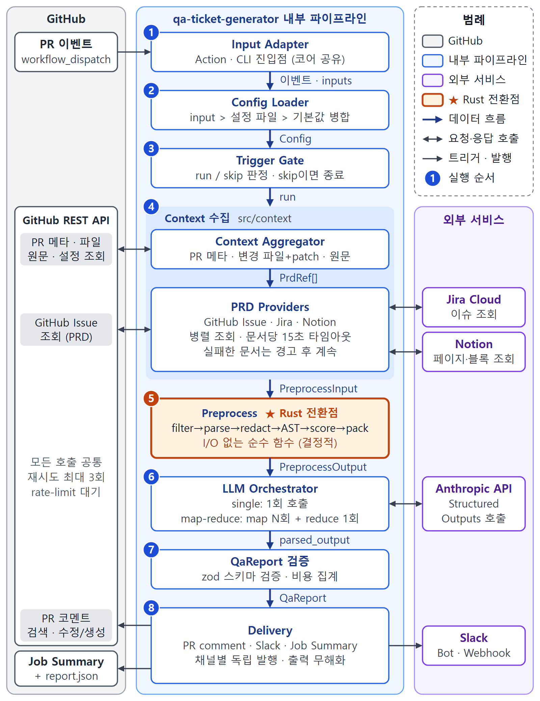

# qa-ticket-generator

[English](../README.md) | [한국어](README.ko.md) | [日本語](README.ja.md) | **简体中文**

<!-- 徽章(CI、发布、许可证)会在仓库公开时加上。 -->

> 🚧 pre-v0.1。在我们的测试仓库里已经能用了,但 input 名称和评论的样子可能还会变。

一个 GitHub Action:把 pull request 和它要实现的需求单放在一起读,然后写出测试同学会写的那种 QA 备注。
哪些需求已经实现、哪些漏掉了、合并前值得跑哪几条测试,都会以评论的形式留在 PR 上。

## Why

小团队一般没有专职 QA,评审的人看 diff 的时候也很少会把 Jira 单子开在旁边。于是 PR 评审通过了,测试也全绿,
过了一周才有人发现有一条验收标准压根没做。

这个 Action 帮你做这一步核对。在 PR 描述里贴上需求单链接,打上 `needs-ai-qa` 标签,一两分钟后 Claude 会留下
一条评论,对比代码和需求。它不是代码审查机器人,不管代码风格,只关心这次改动是不是按需求做了,以及要验证
这一点该测什么。

## What you get

评论大概长这样(v0.1 之前还在打磨):

```markdown
## 🧪 AI QA — 4e2455c · ⚠️ 部分符合

**需要处理 (2)**

- ❌ AC2 过期的优惠券应被拒绝:没有代码把 `expiresAt` 和当前时间比较 (`src/coupon.ts`)
- ❌ AC4 百分比折扣最多 10,000 韩元:没有加上限

**P0 检查清单**

- [ ] TC-01 一秒前过期的优惠券 → 被拒绝,不留下使用记录
- [ ] TC-02 同一用户同时使用同一张优惠券两次 → 只有一次成功
- [ ] TC-03 200,000 韩元订单用 10% 优惠券 → 折扣 10,000,而不是 20,000

<details><summary>TC-01 拒绝过期优惠券 [P0 · AC2]</summary>
前提:user-A 从未用过 EXP1,购物车小计 30,000 韩元
数据:code = EXP1, expiresAt = 当前时间 - 1 秒
步骤:1. 打开结算页 2. 使用 EXP1
预期:抛出 "Coupon has expired" 的 CouponError,(user-A, EXP1) 没有使用记录
</details>

<details><summary>P1 / P2 用例 (9)</summary>…</details>
```

之后再 push 新提交时,它会修改同一条评论,而不是再发一条新的。只改了 lock 文件或构建产物的 push 会被忽略。
如果接上 Slack,频道里会收到一条简短摘要,测试用例放在它的回复串里。

想了解内部流程可以看这张图。



## Setup

只需要一个 Anthropic API key,大概五分钟。

1. 在仓库 secret 里添加名为 `ANTHROPIC_API_KEY` 的 key。
2. 创建一个叫 `needs-ai-qa` 的标签。
3. 把下面的 workflow 保存为 `.github/workflows/qa-ticket-generator.yml`。

```yaml
name: AI QA
on:
  pull_request:
    types: [labeled, synchronize, opened, reopened]

permissions:
  contents: read
  pull-requests: write
  issues: read

concurrency:
  group: qa-ticket-generator-${{ github.event.pull_request.number }}
  cancel-in-progress: true

jobs:
  qa:
    if: contains(github.event.pull_request.labels.*.name, 'needs-ai-qa')
    runs-on: ubuntu-latest
    steps:
      # 这里故意不加 actions/checkout,PR 内容通过 API 读取。
      - uses: ggreing/qa-ticket-generator@v0
        with:
          anthropic-api-key: ${{ secrets.ANTHROPIC_API_KEY }}
```

就这些。给 PR 打上标签,等评论出来就行。如果需求写在 Jira 或 Notion 里,或者想同时发到 Slack,
[`examples/workflow.yml`](examples/workflow.yml) 里列出了所有额外的 input。想要中文输出的话,加一行
`language: zh-CN` 就可以。

来自 fork 的 PR 默认会跳过,因为 GitHub 不会把 secret 交给 fork 的 PR。确实需要的话可以用
[`examples/workflow-fork-opt-in.yml`](examples/workflow-fork-opt-in.yml),但请先读完文件开头的警告。

## Linking the spec

Action 会在 PR 描述里找需求单链接:

- GitHub issue:`#123`、`owner/repo#123`、issue 链接、`Closes #123`
- Jira Cloud:`https://your-site.atlassian.net/browse/PROJ-123`;如果在 `jira-project-keys` 里写了
  `PROJ`,只写 `PROJ-123` 也能识别
- Notion:`notion.so` 或 `notion.site` 的页面链接

验收标准从 "Acceptance Criteria"(或 "AC")标题下的列表,或者复选框列表里读取。没有这样的部分时,就根据整个
需求单正文来判断。代码块和 HTML 注释里的链接会被忽略,所以在 PR 模板里放示例链接也没关系。我们也准备了一个
可以直接用的模板:[`examples/pull_request_template.md`](examples/pull_request_template.md)。

没有关联需求单?它照样会运行,只看代码,并在评论开头说明这一点。如果你宁愿让检查直接失败,用
`require-prd: true`。

## Running it locally

同样的功能也可以当 CLI 用。默认只打印报告,不会发到任何地方:

```bash
export GITHUB_TOKEN=… ANTHROPIC_API_KEY=…
npx qa-ticket-generator run --repo owner/repo --pr 123            # 试运行(默认)
npx qa-ticket-generator run --repo owner/repo --pr 123 --format json --out report.json
npx qa-ticket-generator run --repo owner/repo --pr 123 --publish  # 发布 PR 评论 / Slack 消息
```

所有 Action input 也都可以用大写环境变量传入(`JIRA_BASE_URL`、`MAX_SCENARIOS` 等)。
`npx qa-ticket-generator --help` 可以查看全部参数。

## What it costs

在我们目前试过的小 PR(改动 1 到 3 个文件)上,用 Claude Opus 5.5 跑一次大约 $0.09 到 $0.19,平均 $0.13,
耗时一分钟左右。这是用 10 个合成 PR 和 1 个沙盒 PR 测出来的,只能当个大致参考。

大的 PR 会拆成几次调用,所以会更贵。因此每次运行都有上限:`max-cost-usd`,默认 $2。估计会超出时,会先去掉
不太重要的文件,并在评论里列出去掉了哪些。每次运行的预估费用写在评论最底部。

## Where your code goes

这个 Action 不会 checkout 或运行 PR 里的代码。它通过 GitHub、Jira、Notion 的 API 读取 diff、改动的文件和
关联的需求单,然后发给 Anthropic 的 API。不会发到别的地方,也没有遥测。

发送之前,看起来像密钥的东西(API key、token、私钥、配置里的密码)都会被遮盖,PR 标题和描述也一样。遮盖了
几处会写在评论里。日志里只有数量和大小,不会有文件内容。

还有两点值得知道:

- 仓库配置文件从 base 分支读取,所以 PR 没法改写用来审查它自己的指令。模型写的文字会先转义再发布,Slack 的
  @ 提及会被禁用,链接只允许指向 PR、关联的需求单和你的仓库。
- 两次运行之间的状态保存在它自己评论的隐藏区块里,而且只信任由自己的 token(`github-actions[bot]`,或你传入的
  PAT 的所有者)写的评论。如果同一仓库里另一个 workflow 会以 `github-actions[bot]` 的身份原样转发 PR 作者写的
  内容,这个状态就有可能被伪造。最坏的结果是某次重新运行被跳过,或者改错了一条 Slack 消息。

发现安全问题请私下告诉我们,不要开公开 issue,详见 [`SECURITY.md`](../SECURITY.md)。

## Known gaps

- 在你添加 workflow *之前*就已经打开的 PR,打上标签可能没有任何反应。因为 GitHub 不会刷新那个 PR 的 merge
  提交,它看不到新的 workflow。更新一下分支("Update branch" 按钮或 `gh pr update-branch <number>`),
  之后的 push 就会触发运行。
- Slack 的 incoming webhook 只能发消息,所以每次运行都会多一条新消息。想要原地更新和回复串,请用 bot token
  (`slack-bot-token` 和 `slack-channel`)。
- 默认的 `GITHUB_TOKEN` 读不了其他私有仓库里的 issue。如果需求写在别的仓库,请把 PAT 或 GitHub App 的 token
  传给 `github-token`。
- 目前 Jira 只支持 Cloud(不支持 Server 和 Data Center),GitHub 只支持 github.com(不支持 GHES)。
- Notion 页面需要先分享给你的 integration(页面菜单 → 连接)。
- 模型只看得到改动过的文件。如果某条需求是在 PR 没碰过的文件里处理的,可能会被判成"缺失";这类假设会集中
  写在评论最后。

## Configuration reference

### Inputs

<!-- inputs:start -->
| Input                   | 必填 | 默认值                            | 说明                                                                               |
| ----------------------- | ---- | --------------------------------- | ---------------------------------------------------------------------------------- |
| `anthropic-api-key`     | ✅   | —                                 | Anthropic API key。                                                                |
| `github-token`          |      | `${{ github.token }}`             | 用于读取 PR 和写评论。                                                             |
| `model`                 |      | `claude-opus-5-5`                 | Claude 模型 ID。                                                                   |
| `effort`                |      | `high`                            | `low`、`medium`、`high`、`xhigh`、`max`。越低越便宜越快。                          |
| `language`              |      | `en`                              | `en`、`ko`、`ja`、`zh-CN`(`kr`、`jp`、`cn`、`zh` 也行)。                           |
| `trigger-label`         |      | `needs-ai-qa`                     | 触发运行的标签。                                                                   |
| `rerun-on-push`         |      | `true`                            | 标签还在时,每次新提交都重新运行。                                                  |
| `require-prd`           |      | `false`                           | 读不到关联需求单时让检查失败。                                                     |
| `token-budget`          |      | `150000`                          | 单次模型调用的输入 token。大的 PR 会拆成多次调用。                                 |
| `max-cost-usd`          |      | `2.00`                            | 每次运行的费用上限。超出时先去掉不太重要的文件。                                   |
| `max-scenarios`         |      | `8`                               | 评论里测试用例的最大数量。                                                         |
| `comment-author`        |      | —                                 | 只有用自定义 GitHub App token 时才需要,例如 `my-app[bot]`。                        |
| `pr-comment`            |      | `true`                            | 发布 PR 评论并持续更新。                                                           |
| `slack-bot-token`       |      | —                                 | Slack bot token(`xoxb-`),可以原地更新消息和使用回复串。                            |
| `slack-channel`         |      | —                                 | bot 发消息的频道 ID 或 `#名称`。                                                   |
| `slack-webhook-url`     |      | —                                 | 没有 bot token 时使用的 incoming webhook。                                         |
| `jira-base-url`         |      | —                                 | 例如 `https://acme.atlassian.net`。                                                |
| `jira-email`            |      | —                                 | Jira 账号邮箱。                                                                    |
| `jira-api-token`        |      | —                                 | Jira API token。URL、邮箱和 token 都填了才会用 Jira。                              |
| `jira-project-keys`     |      | —                                 | 用逗号分隔,写了的项目只写 `KEY-123` 也能识别,例如 `PROJ,WEB`。                     |
| `notion-token`          |      | —                                 | Notion integration token。                                                         |
| `config-path`           |      | `.github/qa-ticket-generator.yml` | 仓库配置文件,从 base 分支读取。                                                    |
| `fail-on`               |      | `none`                            | 符合度为 `partial` 或 `misaligned` 时让检查失败。                                  |
| `fail-on-error`         |      | `false`                           | 内部错误时让检查失败。默认只给出警告。                                             |
| `allow-fork-prs`        |      | `false`                           | 允许 fork 的 PR。只在 opt-in workflow 里使用。                                     |
| `server-fallback`       |      | `true`                            | Opus 拒绝请求时,由 Anthropic 换一个模型重试。                                      |
| `mode`                  |      | `auto`                            | `auto` 根据事件判断,`plan` 从需求生成 QA 用例,`verify` 对照 PR。                   |
| `spec`                  |      | —                                 | 手动运行时的需求:issue 编号、Jira key 或 Notion 链接。                             |
| `plan-label`            |      | `needs-qa-plan`                   | 启动计划阶段的 issue 标签。                                                        |
| `sinks`                 |      | `github-issue,file`               | 用例工单写到哪里:`jira`、`github-issue`、`notion`、`file`。                        |
| `notion-qa-database-id` |      | —                                 | 存放 QA 用例的 Notion 数据库。                                                     |
| `jira-subtask-type`     |      | `Sub-task`                        | 用例子任务使用的 Jira 问题类型。                                                   |
| `max-cases`             |      | `80`                              | 每个需求的安全上限,超出时先去掉 P2。                                               |
| `previous-cases`        |      | —                                 | 上次运行的 `qa-cases.json` 路径(例如下载的 artifact),file sink 沿用其中的用例 ID。 |
| `dry-run`               |      | `false`                           | 只把报告写到 Job Summary。                                                         |
<!-- inputs:end -->

### Outputs

<!-- outputs:start -->
| Output             | 说明                                             |
| ------------------ | ------------------------------------------------ |
| `report-path`      | 完整结果 `report.json` 的路径。                  |
| `case-count`       | 计划阶段后有效的 QA 用例数。                     |
| `cases-dir`        | 计划阶段后存放 qa-cases.md、.csv、.json 的目录。 |
| `scenario-count`   | 写出的测试用例数量。                             |
| `alignment-status` | `aligned`、`partial`、`misaligned` 或 `no_prd`。 |
| `cost-usd`         | 本次运行的预估费用。                             |
| `skipped-reason`   | 如果跳过了,原因是什么。                          |
<!-- outputs:end -->

### Repository config file

在仓库里放一个 `.github/qa-ticket-generator.yml`,可以设置要排除的路径、验收标准所在的 Jira 字段,或者补充几行
业务背景。Action 的 input 优先于这个文件。完整示例见
[`examples/qa-ticket-generator.yml`](examples/qa-ticket-generator.yml)。

```yaml
filters:
  exclude: ["**/*.snap", "src/generated/**"]
prd:
  jiraProjectKeys: [PROJ, WEB]
  jiraAcceptanceCriteriaField: customfield_10042
prompt:
  extraInstructions: |
    Partial refunds are supported.
```

## Contributing

欢迎提 bug 和 PR。怎么跑测试写在 [`CONTRIBUTING.md`](../CONTRIBUTING.md) 里(测试不会调用真实 API)。设计文档在
[`SPEC.ko.md`](SPEC.ko.md)(目前只有韩文)和 [`adr/`](adr/)。

许可证是 Apache-2.0,见 [LICENSE](../LICENSE)。
